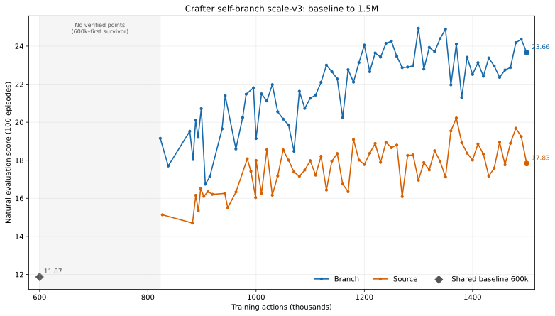

# CraftScaffold｜从练习到独立生存

> **当前结果（2026-10-13）**：Crafter self-branch scale-v3 的 Branch 和 Source 两臂均完成 1.5M 动作训练及 100 局自然评测。共同 600k baseline Score 为 **11.87**，实际共同恢复的 610k 检查点补测为 **12.41**；1.5M 时 Branch **23.66**、Source **17.83**。已测峰值分别为 Branch **24.94（1.3M）**、Source **20.22（1.37M）**。石镐成功率在 1.5M 为 **56% / 40%**；两臂铁镐均为 **0%**。每臂目前只有一个训练种子，结论是有希望的配对结果，仍需复验。



[查看逐检查点数据 CSV](docs/results/scale-v3-600k-to-1500k/scores.csv) · [评测与清理审计](docs/results/scale-v3-600k-to-1500k/cleanup-audit.json) · [技术路线与证据边界](docs/technical-route-iterations.md)

图中 600k 是共享 baseline 评测锚点，610k 是两臂共同完整起点的独立评测。620k–800k 两臂均有每10k节点的100局自然评测；810k–900k 从各自800k节点续训并每10k评测100局；其余800k–1M仅展示实际保留的不等间距节点；1M–1.5M 为每10k评测。图只展示已验证的真实节点，长缺口断线，不把训练回报或插值当作评测分数。

## 项目在解决什么问题

Crafter 是包含采集、生存和工具制作的二维游戏，共有 22 项成就。我们用 DreamerV3 研究：在不提供专家动作标签的前提下，训练经验的组织方式能否改善长链工具能力。

当前路线没有改 DreamerV3 的网络结构或策略输入。Branch/Source 的区别只在训练期成功轨迹回放数据的来源；部署时模型不接收轨迹来源、成就真值或目标技能。

## 技术路线演进

初始的三线课程实验是项目的历史工程阶段：自然训练、固定辅助出生、前置后撤除辅助，各 3 个随机种子、每模型 300k 动作。综合 Score 均值分别为 **5.90、6.60、6.42**；平均收益有限且种子间波动明显，石镐、铁镐等高级能力仍不稳定。它促使我们从“是否给初始帮助”转向检查模型是否会利用成功机会。README 不再展示该阶段的图片。

后续小批次筛选逐步收窄问题：

- **行为探索试探**：短时随机动作覆盖增加了训练中石镐、铁镐解锁事件，但自然评测没有改善，准备石镐/铁镐均为 0/30；未进入长训。
- **CR-inspired 回放试探**：30 局自然 Score 为 12.74，对照为 12.23，但目标技能仍为 0/30；不足以晋级。它是本地启发式试探，不是 Curious Replay 的完整复现。
- **Branch 与 Source 对照**：改为比较“多分支成功轨迹”与“匹配数量的源策略成功轨迹”，控制相同起点、训练预算和回放机制。scale-v2 两个地图命名空间的 actor-alone 测试中，Branch Score 为 **16.17/14.45**、石镐 **14/100、10/100**；Source 为 **13.07/12.81**、石镐 **0/100、0/100**。这组短程信号促使两臂进入 scale-v3；另测的推理期制作筛选器不属于 scale-v3。协议、局限和筛选细节见[技术路线记录](docs/technical-route-iterations.md)。

## 当前双路线

| 路线 | 训练期回放数据 | scale-v3 结果 |
|---|---|---|
| **Branch** | 从冻结策略的分支构造中收集、经原生环境验证的成功完整轨迹；bank 为 26 条序列、5,881 个转移 | 1.5M Score **23.66**；已测峰值 **24.94**；石镐 **56/100** |
| **Source** | 同一源策略的成功轨迹，按 Branch 的数量和转移规模匹配；约 26 条序列、6,000 个转移 | 1.5M Score **17.83**；已测峰值 **20.22**；石镐 **40/100** |

两臂使用同一 610k 完整检查点、相同 seed/config、自然场景训练预算和 CR 回放机制；Branch/Source 指回放 bank 的来源，不是不同模型结构或不同 baseline。Branch 的构造过程不作为专家标签，学生策略仍通过环境奖励和 DreamerV3 学习。

scale-v3 对 1.01M–1.5M 每个 10k 节点各做 100 局自然评测；存活的 pre-1M 节点也已补测。完整分数及单项能力在 CSV。结果显示 Branch 的整体分数和石镐能力有更强的持续改善信号，但高阶链条仍未打通：两臂铁镐与钻石成功率都是 0%。分数有波动，峰值不等于最终成绩；单种子结果不能证明稳定因果收益。

## 复现入口

当前分支的 scale-v3 专项说明见[复现与制品清单](docs/scale-v3-reproduction.md)。权重与 latent replay bank 不进入 GitHub；在外部制品补齐前，代码、协议和分析可复现，但历史数值曲线不能仅凭 GitHub 克隆重建。

需要 Linux / Python 3.11；Windows 用户请使用 WSL2。CPU 安装与基础检查：

```bash
git clone https://github.com/TwilightGlimmer/craft-scaffold.git
cd craft-scaffold
bash setup.sh cpu
./python.sh tools/doctor.py
./python.sh tools/validate_runtime.py
```

GPU 训练前运行 `bash setup.sh cuda` 和 `./python.sh tools/validate_runtime.py --gpu`。配置、运行目录和恢复说明见 [工程迁移指南](docs/portability.md)。安装和运行通过 `./python.sh` 管理仓库环境。

## 证据与范围

- [scale-v3 每节点 Score 与技能成功率](docs/results/scale-v3-600k-to-1500k/scores.csv)
- [技术路线迭代及小批次筛选说明](docs/technical-route-iterations.md)
- [旧 RA-HB v2 路线复盘](docs/ra-hb-v2-postmortem.md)：独立失败路线，不与 self-branch 曲线混合
- [第三方声明](THIRD_PARTY_NOTICES.md)与 [DreamerV3 上游集成补丁](docs/upstream-integration.patch)

我们不据此宣称新算法、统计显著性、铁镐链已解决或跨环境泛化。公开仓库中的结果只支持所列协议和已验证检查点。
